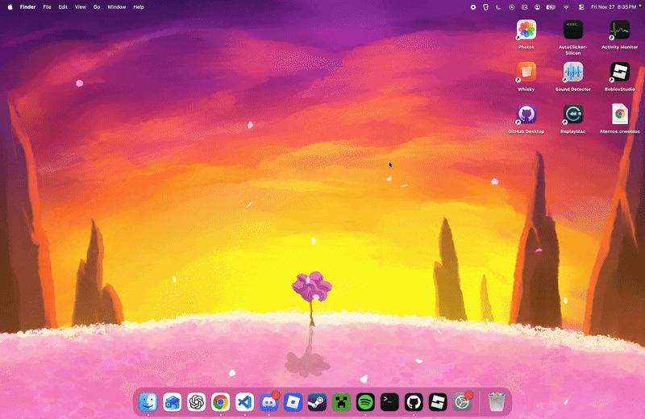

<p align="center">
  
  <br />
  <strong>Sound Detector App (Available for macOS and Windows)</strong>
</p>

# Sound Detector

Sound Detector app that actively listens for your device audio in the background.

Works by using Discord webhook URLs and Discord API to send notifications to your Discord server  
when the detected device audio passes a configurable threshold, and can also optionally send live volume reports.  




---

## Installation & Setup

### macOS

Open the `.dmg` file and drag the Sound Detector app into the Applications folder.  
If macOS blocks you from opening the app, open **System Settings > Privacy & Security** and allow the app to run.  
Grant any requested microphone or audio input access so it can listen to the selected device.

---

### Windows

Open the `.exe` file and double-click it.
If Windows SmartScreen displays a warning, confirm that the file came from the project's Releases page before choosing **More info > Run anyway**.  
Allow audio input access if Windows requests it.

Ensure your desktop session and selected audio input allow the program to capture the audio you want to monitor.

---

### Audio Device Setup

The program listens to an audio input device.  
To capture internal desktop or game audio, you may need a virtual audio device and must route the audio output to it.

On macOS, a virtual device such as BlackHole 2ch can route system audio to the program.  
On Windows, options can include VB-Cable or Stereo Mix / “What U Hear,” depending on the device and setup.  

Select and verify the appropriate input device in your system's audio settings.

---

### Discord Server Setup

You need to have the following:  
* A Discord server
* Your Discord user ID
* One or two Discord webhook URLs connecting to your Discord server

Watch the video on how to create a Webhook URL to use.

https://github.com/user-attachments/assets/f54a4fff-6897-4704-860c-24cd994fd8e7

Click on `New Webhook` to make another webhook if you want to receive live volume reports (assuming your first is for notifications).

```
To get your Discord user ID, you need to go to your User Settings.  
Scroll to the bottom on the left side bar, find Developer, and enable Developer Mode  

Then right click your Discord username and copy User ID.
```

## Configuration

Running the script will automatically create an .env file in your user directory.  
Add your Discord webhook URL(s) and Discord user ID through the GUI that opens up.  

To edit your settings, you can also change the values through the GUI or through the `config.json` file.

---

## Troubleshooting

| Error | Common cause | What to check |
| --- | --- | --- |
| `requests.exceptions.MissingSchema` or `InvalidURL` | Missing or malformed webhook URL | Confirm `.env` exists and your URL(s) begins with `https://discord`. |
| `requests.exceptions.RequestException` | Network connection or Discord service issue | Check your connection and Discord availability, then retry. |
| `requests.exceptions.JSONDecodeError` | Discord returned a non-JSON error response | Check the connection and response handling in `send_discord_ping()`. |
| `sounddevice.PortAudioError` | Input device disconnected, unavailable, or busy | Check that the selected input or virtual audio device is connected and active. |
| `zoneinfo.ZoneInfoNotFoundError` | Time zone database is unavailable | Install system time zone data; on some Windows Python setups, install `tzdata`. |
| `ModuleNotFoundError` | Required Python package is missing | Install the packages listed under **Requirements**. |

---

## Developer Notes

Made with love by @Crystallization (@crystallizationn).  

Package Versions:

* `requests==2.34.2`
* `numpy==2.5.2`
* `sounddevice==0.5.6`
* `python-dotenv==1.2.3`
* `tzdata==2026.6`
* `pytz==2026.3.post1` (for non-released version of v0.31)
* `pillow==13.0.0`  

Discord Color Values:

* Red: `0xFF0000`
* Green: `0x57F287`
* Yellow: `0xFEE75C`
* Blurple: `0x5865F2`
